# Backup and Recovery Project: rsync + cron on Ubuntu Server

A small, hands-on backup and disaster-recovery (DR) lab. A bash script uses `rsync` to take timestamped snapshots of a folder, `cron` runs it on a schedule, and I then deleted files on purpose and restored them from a snapshot. The restore was verified with SHA-256 checksums.

## Summary

| Stage | Result |
|-------|--------|
| Backup script (`rsync --link-dest` snapshots + log) | Works |
| Scheduled runs via cron (every 2 minutes during the test) | Ran on its own, 5 consecutive runs logged |
| Disaster: delete files | `report.txt` and `photos/` removed |
| Restore from a snapshot | Files recovered |
| Verification | All 4 checksums `OK` |

## Environment

- Ubuntu Server 24.04 LTS running in a VMware virtual machine
- Accessed over SSH from Windows PowerShell
- `rsync` 3.2.7 (protocol 31)
- `cron.service` active and enabled
- Project folder on the server: `~/backup_demo`

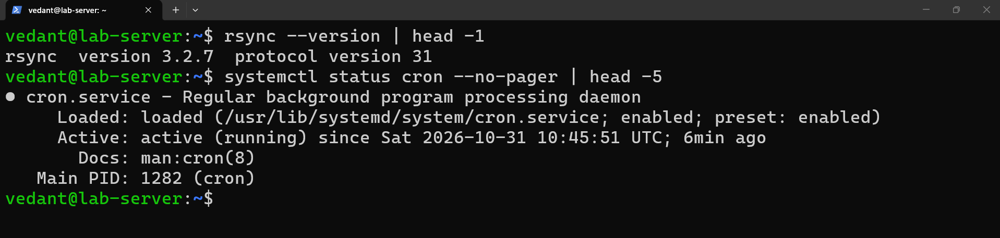
*Figure 1: Tool check on Ubuntu Server 24.04. rsync 3.2.7 is installed, and cron.service is active (running) and enabled to start on boot.* 

## 1. Test data

A small folder with a mix of text and binary files:

```bash
mkdir -p ~/backup_demo/data
cd ~/backup_demo/data
echo "Quarterly report" > report.txt
echo "Customer list" > customers.csv
mkdir photos
head -c 1M /dev/urandom > photos/img1.bin
head -c 1M /dev/urandom > photos/img2.bin
```

Before any backup, I recorded a SHA-256 checksum of every file. This is the reference used later to prove the restore is exact:

```bash
find . -type f -exec sha256sum {} + | sort -k2 > ../before.sha256
cat ../before.sha256
```

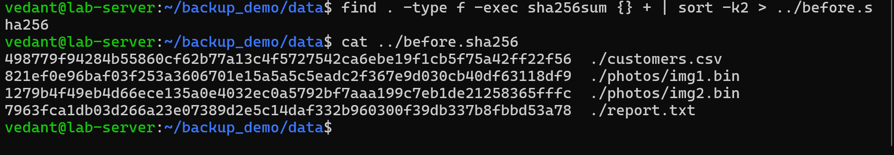
*Figure 2: SHA-256 checksums of the four test files (`customers.csv`, `photos/img1.bin`, `photos/img2.bin`, `report.txt`), recorded before the first backup as the reference for verifying the restore.*

## 2. The backup script

`backup.sh`:

```bash
#!/usr/bin/env bash
set -euo pipefail

BASE="$HOME/backup_demo"
SRC="$BASE/data/"
DEST="$BASE/backups"
LOG="$BASE/backup.log"
STAMP=$(date +%Y-%m-%d_%H-%M-%S)
LATEST="$DEST/latest"

mkdir -p "$DEST"
echo "[$(date '+%F %T')] Backup started" >> "$LOG"

if [ -e "$LATEST" ]; then
  rsync -a --delete --link-dest="$LATEST/" "$SRC" "$DEST/$STAMP/" >> "$LOG" 2>&1
else
  rsync -a --delete "$SRC" "$DEST/$STAMP/" >> "$LOG" 2>&1
fi

ln -sfn "$DEST/$STAMP" "$LATEST"
echo "[$(date '+%F %T')] Backup finished: $STAMP" >> "$LOG"
```

How it works:

- Each run creates a new timestamped folder that looks like a complete copy of the source.
- `--link-dest` tells rsync to hard-link files that have not changed since the previous snapshot (`latest`) instead of copying them again. Unchanged files take no extra disk space.
- `set -euo pipefail` makes the script stop on errors instead of continuing silently.
- Every run writes a "started" and a "finished" line to `backup.log`. A "started" line with no matching "finished" line means a run did not complete.
- `latest` is a symlink that always points to the newest snapshot.

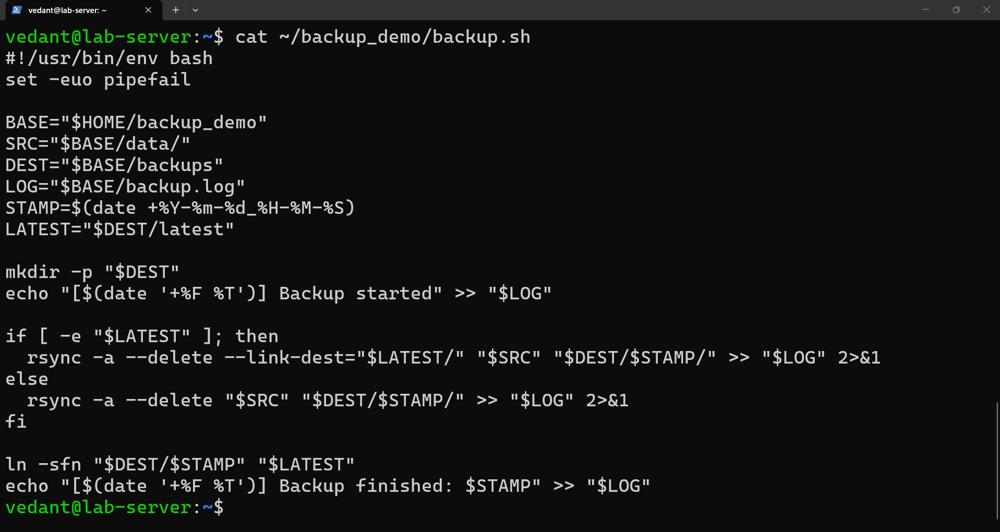
*Figure 3: The backup script `backup.sh`. It uses `rysnc -a --delete --link-dest` to create timestamped snapshots, updates a `latest` symlink, and logs the start and end of each run.*

### First manual run

```bash
chmod +x ~/backup_demo/backup.sh
~/backup_demo/backup.sh
ls ~/backup_demo/backups
tail ~/backup_demo/backup.log
```

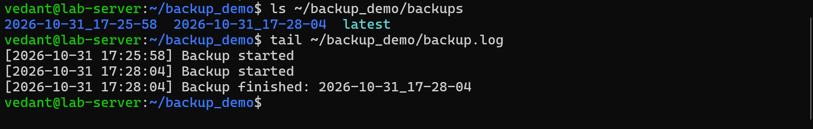
*Figure 4a: Output of the first manual runs. The `backups` folder holds two timestamped snapshots plus `latest`. The log shows the first run (17:25:58) with no "finished" line, and the second run (17:28:04) completeing normally.*

**Note on the first run:** the log shows `17:25:58 Backup started` with no matching "finished" line, so the first attempt did not complete cleanly. I did not determine the exact cause. A second manual run at `17:28:04` completed normally. To check that the first snapshot was still intact, I compared both it and `latest` against the source folder:

```bash
diff -r ~/backup_demo/data ~/backup_demo/backups/2026-10-31_17-25-58 && echo "first snapshot OK"
diff -r ~/backup_demo/data ~/backup_demo/backups/latest && echo "latest OK"
```

Both printed OK, so the data in the first snapshot is complete. Only its log line is missing. I left it in place rather than cleaning it up.

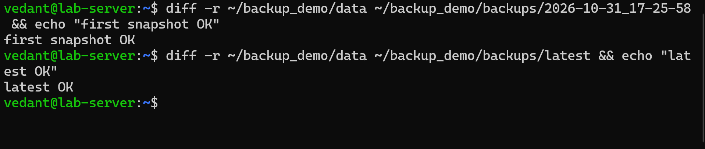
*Figure 4b: `diff -r` comparison of the source folder against the first snapshot and against `latest`. Both report OK, which shows the interrupted first run still produced a complete snapshot.* 

## 3. Scheduling with cron

I added this line with `crontab -e`. It runs the script every 2 minutes, which makes the schedule easy to observe during a test. It uses an absolute path because cron does not expand `~` the way an interactive shell does:

```
*/2 * * * * /home/vedant/backup_demo/backup.sh
```

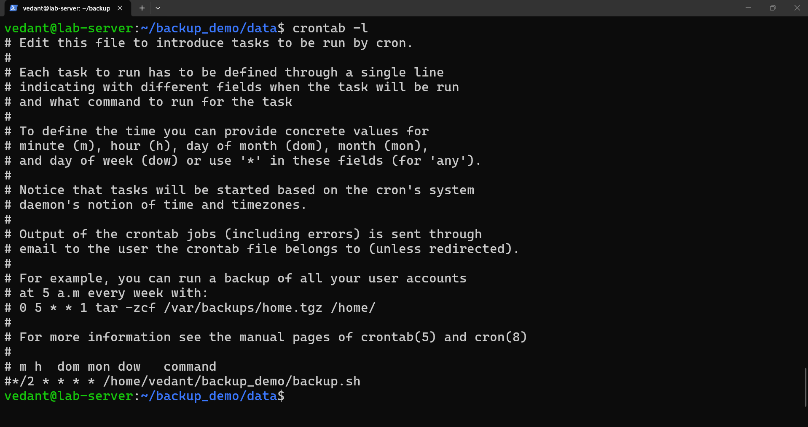
*Figure 5a: The corntab entry `*/2 * * * * /home/vedant/backup_demo/backup.sh`, which runs the backup every 2 minutes for testing, using an absolute path.* 

After letting it run, the log shows cron starting the job on its own, with a matching "started" and "finished" pair for each run, two minutes apart (18:20:01, 18:22:01, 18:24:01, 18:26:01, 18:28:01):

```bash
ls ~/backup_demo/backups
cat ~/backup_demo/backup.log
```

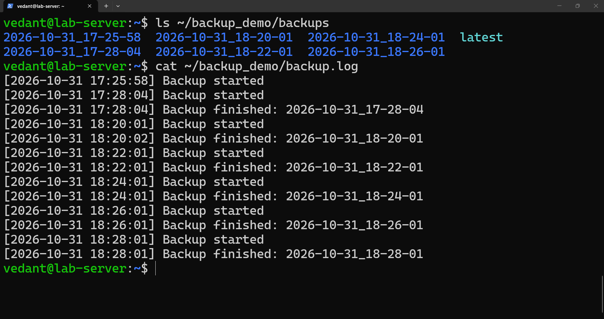
*Figure 6a: Evidence that cron ran the script on its own. The backup folder holds new snapshots, and the log shows "started" and "finished" pairs at 18:20:01, 18:22:01, 18:24:01, 18:26:01 and 18:28:01, two minutes apart.*

### Disk usage: the hard-link saving

```bash
du -sh ~/backup_demo/backups/*
```

The first snapshot is 2.1M. Every later snapshot shows 8.0K, which is just directory entries, because the unchanged files are hard-linked to the first one. `latest` shows 0 because it is only a symlink. `du` counts a shared file once, under the first snapshot it meets, so the small numbers do not mean the later snapshots are incomplete. They are full copies, and the `diff -r` check above confirms it.

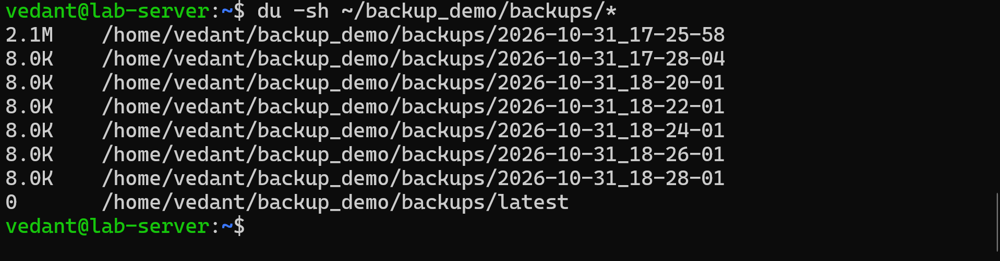
*Figure 6b: Disk usage per snapshot. The first snapshot is 2.1M and each later one is 8.0K, because unchanged files are hard-linked to the first snapshot. `latest` shows 0 because it is only a symlink.*

### Cron paused

After the scheduled runs, I commented the line out so that no new backup would capture the deleted state during the disaster test. `crontab -l` shows the entry prefixed with `#`:

```
#*/2 * * * * /home/vedant/backup_demo/backup.sh
```

The last scheduled snapshot in the log is `18:28:01`.

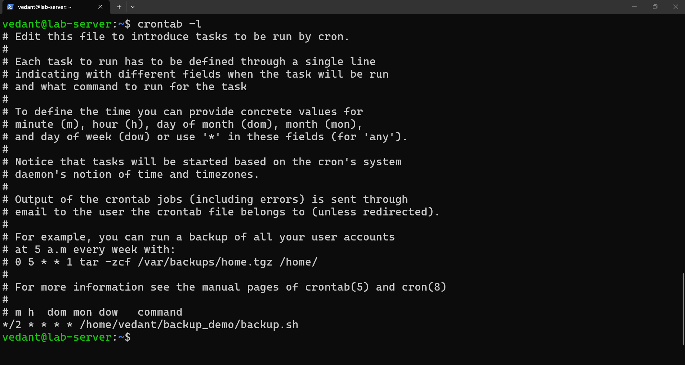
*Figure 5b: `crontab -l` after the test. The entry is commented out with `#`, so cron no longer creates snapshots and cannot back up the deleted state during the disaster test.* 

## 4. Disaster simulation

I deleted a file and a directory from the source folder:

```bash
rm ~/backup_demo/data/report.txt
rm -r ~/backup_demo/data/photos
ls -R ~/backup_demo/data
```

Only `customers.csv` remained.

**Note on the errors in the screenshot:** the session also contains two harmless `rm` errors. I first ran `rm` on the `photos` directory without `-r`, which fails with "Is a directory", and then ran `rm` on `report.txt` a second time, which failed with "No such file or directory" because the first call had already deleted it. Neither error affected the result.

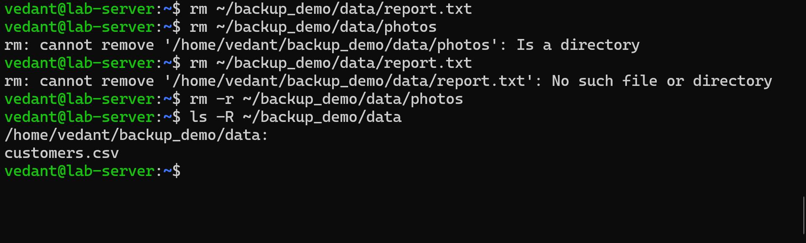
*Figure 7: Simulated disaster. `report.txt` and the `photos` directory are deleted, and only `customer.csv` remains. The two `rm` errors come from a missing `-r` flag and a repeated delete, and did not affect the result.* 

## 5. Restore

I restored from the `2026-10-31_18-24-01` snapshot, which was taken before the deletion:

```bash
rsync -a ~/backup_demo/backups/2026-10-31_18-24-01/ ~/backup_demo/data
ls -R ~/backup_demo/data
```

I did not use `--delete` on the restore. That flag would make the folder match the snapshot exactly, which is not needed here. `report.txt` and `photos/img1.bin` and `photos/img2.bin` were back.

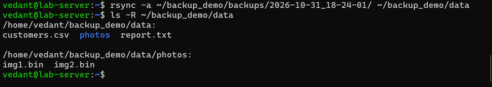
*Figure 8: Restore with rsync -a rom the `2026-10-31_18-24-01` snapshot. `report.txt` and `photos/` (with `img1.bin` and `img2.bin`) are back in the data folder.* 

## 6. Verification

The restored files were checked against the checksums recorded before the first backup:

```bash
cd ~/backup_demo/data
sha256sum -c ../before.sha256
```

All four files report `OK`, so the restored data is byte-for-byte identical to the original.

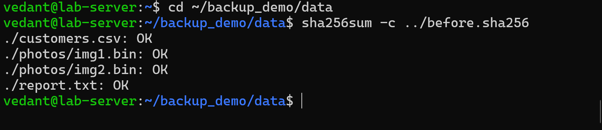
*Figure 9: Verification with `sha256sum -c` against the original checksums. All four files report OK, so the restored data is identical to the original.* 

The screenshot timestamps (taken from the Windows host clock) confirm the order of events: deletion first, then restore, then verification about two minutes after the restore.

## 7. Files in this repository

| File | Description |
|------|-------------|
| `artifacts/backup.sh` | The backup script |
| `artifacts/backup.log` | Copy of the real log from the test |
| `artifacts/crontab.txt` | The crontab as saved on the server |
| `screenshots/` | Evidence for each step |

The `backups/` and `data/` folders are intentionally not committed.

## 8. Limits and what I would do next

This project covers accidental file deletion. It does not cover everything a real disaster recovery plan needs:

- **Same disk, same machine.** The snapshots live on the same disk as the source data. If the disk, the VM, or the host fails, the data and every backup are lost together. A real setup needs a copy on a separate machine or in cloud storage (for example `rsync` over SSH to another host).
- **No pruning.** Old snapshots are never deleted, so the backup folder grows forever. A retention policy (for example keep 7 daily and 4 weekly snapshots) would fix this.
- **Hard links share data.** Because unchanged files are shared between snapshots, silent corruption of one stored file would show up in every snapshot that links to it. Periodic checksum checks help catch this.
- **Failure of a run is not reported.** The log records an unfinished run, but nothing alerts anyone. I would add alerting or a periodic check of the last "finished" line.
- **Verification covers four files.** The checksum test proves these four files were restored exactly. It is not a full audit of an arbitrary dataset.
- **Test schedule.** The 2-minute interval was for the demonstration. A realistic schedule would be nightly, for example `0 2 * * *`.
- **Restores were tested once**, on a single scenario (delete, restore from a recent snapshot). A real DR plan would also test restoring to a clean machine and measure how long recovery takes.V


